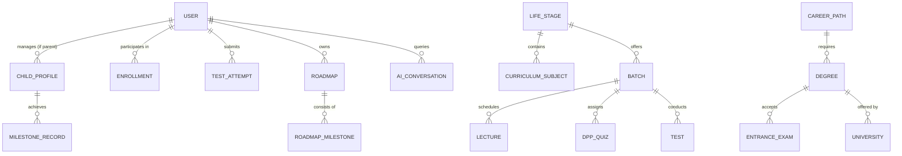

# NextStep OS – Database Schema & Entity Relationship Specification

**Document Version:** 1.0.0  
**Storage Engine:** MongoDB Atlas (Mongoose Document Models) & PostgreSQL Prisma-Compatible Schema

---

## 1. Entity-Relationship Overview

---

## 2. Core Entity Definitions

### 2.1 Identity & RBAC
- **User (`users`)**:
  - `_id`: ObjectId / UUID
  - `name`: String
  - `email`: String (unique)
  - `password`: String (bcrypt hash)
  - `role`: Enum `['parent', 'student', 'mentor', 'admin']` (default: `'student'`)
  - `phone`: String (optional)
  - `avatar`: String (URL or emoji avatar)
  - `lifeStage`: Enum `['playway_1_4', 'primary_5_10', 'middle_11_14', 'stream_selection_15_16', 'entrance_prep_17_18', 'degree_college_19_23', 'career_launch']`
  - `targetExam`: String (`'JEE'`, `'NEET'`, `'UPSC'`, `'CUET'`, etc.)
  - `createdAt`: ISODate, `updatedAt`: ISODate

- **ChildProfile (`child_profiles`)**:
  - `_id`: ObjectId
  - `parentId`: ObjectId (ref: `User`)
  - `name`: String
  - `dob` / `age`: Number
  - `lifeStage`: Enum
  - `interests`: Array of Strings
  - `currentSchool` / `class`: String
  - `developmentalNotes`: Array of Strings
  - `createdAt`: ISODate

### 2.2 Learning & Content
- **Batch (`batches`)**:
  - `_id`: ObjectId
  - `name`: String (e.g., *"Lakshya JEE 2026"*, *"Little Explorers Playway"*)
  - `code`: String (unique)
  - `lifeStage`: String (ref: `LifeStage`)
  - `targetExam` / `grade`: String
  - `price`: Number (`0` for free)
  - `instructors`: Array of Strings
  - `banner`: String
  - `startDate`, `endDate`: ISODate
  - `enrolledCount`: Number

- **Lecture (`lectures`)**:
  - `_id`: ObjectId
  - `batchId`: ObjectId (ref: `Batch`)
  - `title`: String
  - `subject`: String
  - `videoUrl`: String (YouTube embed / Cloud HLS)
  - `durationMinutes`: Number
  - `chapterIndex`: Number
  - `notesPdfUrl`: String
  - `isLive`: Boolean

- **DPPQuiz (`dpp_quizzes`)**:
  - `_id`: ObjectId
  - `lectureId`: ObjectId (ref: `Lecture`)
  - `title`: String
  - `questions`: Array of `{ questionText, options: [String], correctIndex: Number, explanation: String, difficulty: String }`
  - `timeLimitMinutes`: Number

### 2.3 Examinations & Assessments
- **Test (`tests`)**:
  - `_id`: ObjectId
  - `title`: String
  - `examType`: Enum `['JEE_MAIN', 'NEET', 'BOARD_10', 'BOARD_12', 'CUET', 'OLYMPIAD']`
  - `totalQuestions`: Number
  - `durationMinutes`: Number
  - `markingScheme`: `{ correct: Number, incorrect: Number }`
  - `questions`: Array of Question Objects

- **TestAttempt (`test_attempts`)**:
  - `_id`: ObjectId
  - `userId`: ObjectId (ref: `User`)
  - `testId`: ObjectId (ref: `Test`)
  - `score`: Number
  - `maxScore`: Number
  - `accuracy`: Number
  - `timeSpentSeconds`: Number
  - `submittedAt`: ISODate

### 2.4 Career, Degree & Life Skills
- **CareerPath (`career_paths`)**:
  - `_id`: ObjectId
  - `title`: String (e.g. *"Full-Stack Software Engineer"*, *"Data Scientist"*, *"Civil Services Officer"*)
  - `category`: String (`'Technology'`, `'Medical'`, `'Civil Services'`, `'Business'`)
  - `overview`: String
  - `requiredDegrees`: Array of Strings
  - `keySkills`: Array of Strings
  - `projectMilestones`: Array of Strings
  - `growthOutlook`: String
  - `alternativeOptions`: Array of Strings

- **Degree (`degrees`)**:
  - `_id`: ObjectId
  - `name`: String (e.g. *"B.Tech Computer Science"*, *"BCA"*, *"MBBS"*)
  - `durationYears`: Number
  - `eligibilityCriteria`: String
  - `entranceExams`: Array of Strings
  - `coreCurriculum`: Array of Strings
  - `careerOutcomes`: Array of Strings

### 2.5 Roadmaps & Universal AI
- **Roadmap (`roadmaps`)**:
  - `_id`: ObjectId
  - `userId`: ObjectId (ref: `User`)
  - `title`: String (e.g., *"Path to IIT-Bombay CSE"*, *"Early Childhood Motor Development"*)
  - `targetRole` / `targetGoal`: String
  - `lifeStage`: String
  - `milestones`: Array of `{ phaseTitle: String, duration: String, keyTasks: [String], isCompleted: Boolean }`
  - `createdAt`: ISODate

- **AIConversation (`ai_conversations`)**:
  - `_id`: ObjectId
  - `userId`: ObjectId (ref: `User`)
  - `persona`: Enum `['parent_advisor', 'socratic_tutor', 'career_coach', 'interview_mentor']`
  - `messages`: Array of `{ role: 'user' | 'model', content: String, timestamp: ISODate }`
